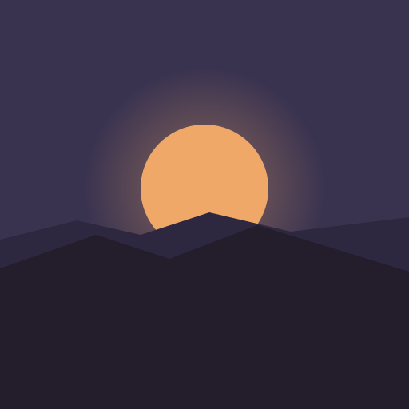
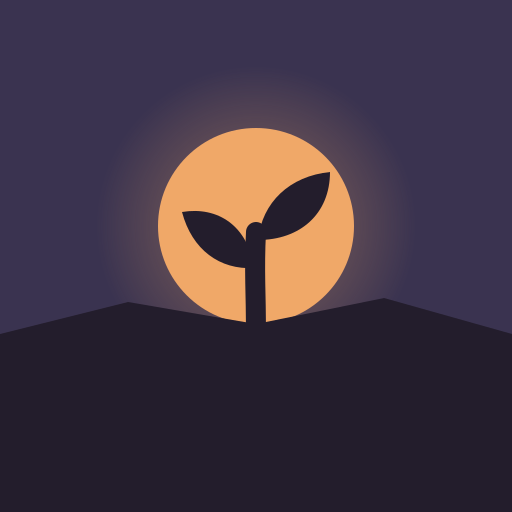
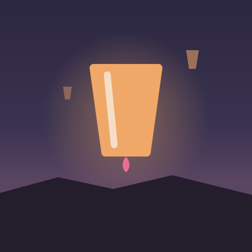

#+TITLE: Profile pictures
#+STARTUP: showall

Profile pictures for the maker's account =mtwabpin=, which publishes Kolahal and Grove. They are not
the app's icon and not the pictures of Kolahal's Discord server (those are in [[file:../discord/][docs/discord/]]).
Nothing here is uploaded by itself.

* The pictures

Each drawing is an SVG, 512 × 512, with PNG exports at 512 and 1024 px (=-512.png=, =-1024.png=).

- : Sun over the ridge. The sun low behind two ridges.
- : The prompt as a peak. A cream prompt chevron drawn as a mountain peak under the sun.
- : A seedling at dusk. A two-leaf seedling against the sun.
- : A sky lantern. A glowing lantern rising over the ridge, with two small ones behind.

* Colors

The app icon's sky =#3A3350=, sun =#F0A868=, ridge =#231D2C= and cream =#F2E2C4=, with Rosé Pine
accents (the lantern's flame =#EB6F92=, the glow =#EBBCBA=). The colors are fixed: the pictures do
not follow a theme.

* Cropping

The drawings are square and full bleed, with no rounded corners or circle. Services crop to a circle
themselves, so everything that matters sits inside the circle a round crop leaves.

* Rendering

The PNGs are rendered from the SVGs (=nix shell nixpkgs#librsvg= where =rsvg-convert= is missing):

#+begin_src sh
rsvg-convert -w 1024 -h 1024 avatar-peak.svg -o avatar-peak-1024.png
rsvg-convert -w 512 -h 512 avatar-peak.svg -o avatar-peak-512.png
#+end_src
