#+TITLE: Kolahal on Discord
#+STARTUP: showall

The pictures of Kolahal's Discord server, in the colors of the app's =rose-pine= theme (Rosé Pine,
=Palettes.rosePine= and =rosePineLight= in =ui/theme/Theme.kt=). Nothing here is uploaded by itself:
each file says where on Discord it goes.

The sources are in [[file:src/][src/]]: SVG for the drawings, HTML for the pictures with words or scenes, and
JPEG for the scenes. Their colors are placeholders, filled in from the app's themes. Render everything
again after a change, or for a new release's event cover:

#+begin_src sh
(cd site && pnpm install --frozen-lockfile)   # once: the website's type
tools/discord-graphics.sh                     # rose-pine, here
tools/discord-graphics.sh nord                # another theme, into build/pictures/nord/discord/
#+end_src

It needs Node.js, Google Chrome or Chromium and ImageMagick (=nix shell nixpkgs#imagemagick= where it
is missing), checks each file's size against Discord's limits, and takes the event cover's version
from =versionName= in =app/build.gradle.kts=. The scenes in [[file:src/scenes/][src/scenes/]] are stills of the app's
shaders, drawn by =tools/site-scenes.sh=. How the placeholders and the scenes work:
[[file:../pictures.org][pictures.org]].

Discord's limits below are as Discord's help pages and upload screens gave them in November 2026.
Discord changes them now and then; the upload screen has the last word.

* The server

- : Server icon (Server Settings → Overview → Server Icon). The website's icon in
  Rosé Pine: the log's bar, two lines and the prompt over a dusk scene. 512 × 512 PNG; Discord crops
  it to a circle, and everything that matters is inside it. JPG, PNG or GIF (a moving one from boost
  level 1).
- 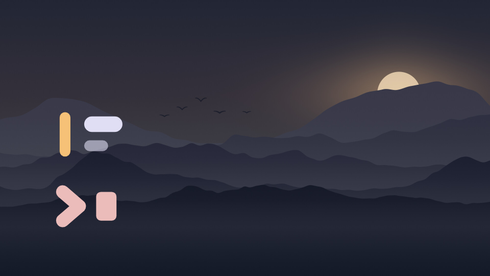: Server banner (Server Settings → Overview → Server Banner Background, from
  boost level 2). The mountains at dusk, with the log and the prompt low on the left. 960 × 540,
  16:9, shown above the channel list with the server's name over its top, so it has no words.
  At least 960 × 540; up to 10 MB.
- : Invite background (Server Settings → Overview → Server Invite
  Background, from boost level 1). The pond under the moon, with no words: Discord puts the invite
  in the middle. 1920 × 1080, 16:9; up to 10 MB.
- 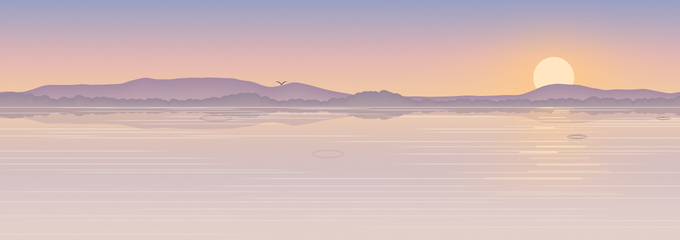: Profile banner for an account or bot that speaks for Kolahal (a user's
  Profile → Banner, which needs Nitro; or the bot's Banner in the Developer Portal). The pond at
  dusk in Rosé Pine Dawn, with no words: the avatar sits on its lower left. 680 × 240, at least
  600 × 240; up to 10 MB.
- 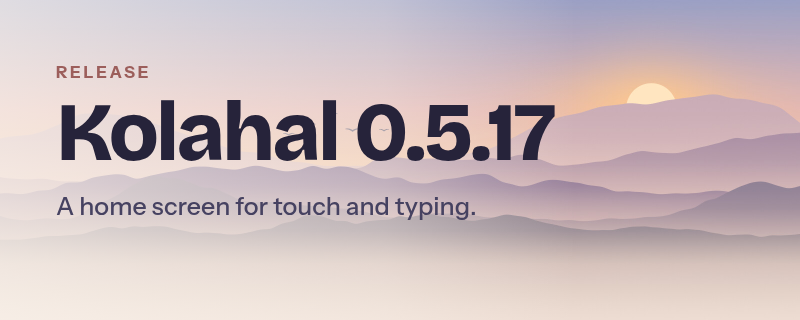: Event cover (Create Event → Cover Image), for a release: "Release",
  "Kolahal 0.5.17" and "A home screen for touch and typing." over the mountains at dusk. 800 × 320,
  5:2; guides give 800 × 320 or 800 × 400, so check the crop on the upload screen. Render it again
  for each release.

* Emoji

128 × 128 PNG with clear corners, each a few KB (Discord's limit is 256 KB; it shows emojis at
22 × 22 in a line of text and 48 × 48 large or as a reaction). Upload in Server Settings → Emoji →
Upload Emoji; the file's name without =.png= becomes the emoji's name, such as =:kolahal_bug:=
(2 to 32 letters, digits and underscores). A server has 50 slots for still emojis at boost level 0.

Each one has a dark outline (Rosé Pine's base) or sits on a dark plate, so it reads on Discord's
light and dark themes alike.

The app's own marks:

- : The server's icon, small. For Kolahal itself.
- : The prompt's chevron and caret. For typing a command, or the app's way of doing things.
- : A log group: its colored bar and two lines of an answer. For the log, or an answer in it.
- : The app selector's bubble with a letter, and the wave of letters along the edge. For the app selector.
- : A widget card with its scalloped badge and a bar chart. For widgets.
- 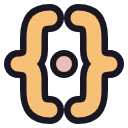: A script's braces. For scripts, and for sharing one.
- : A sun over the mountains, as the shaders draw scenes. For shaders and scenes.
- 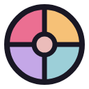: Rose, gold, foam and iris in a circle. For themes and colors.
- 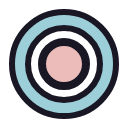: A tap with its ripple. For gestures and touch.
- : A key with the prompt's chevron. For typing and the keyboard.
- : A sky lantern, from the lanterns scene. For good night, or for something well made.

For the server's everyday talk:

- 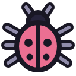: A bug. For a bug report, or "this is a bug".
- : A light bulb. For an idea or a feature request.
- : A question mark in a speech bubble. For a question, or "can you say more?".
- : An open book. For "the user's guide answers this".
- : A phone in a viewfinder. For "a screenshot, please".
- : A magnifying glass with a question mark. For "can't reproduce".
- : A phone with a check mark. For "works on my phone".
- 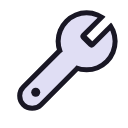: A wrench. For "being worked on".
- : An hourglass. For "planned, not yet done".
- : A check mark. For done, fixed or yes.
- : A cross. For no, won't do, or doesn't work.
- : A rocket. For a release, or "in the next release".
- : +1. For "me too" on a request.
- : A heart. For thanks.

* Stickers

320 × 320 PNG with a clear background, each with a pale cut edge so it reads on dark and light
themes. Discord asks for exactly 320 × 320 and up to 512 KB (PNG, APNG or GIF). Upload in Server
Settings → Stickers → Upload Sticker, with a name (2 to 30 characters), a related emoji and a
description for screen readers. A server has 5 sticker slots at boost level 0.

- 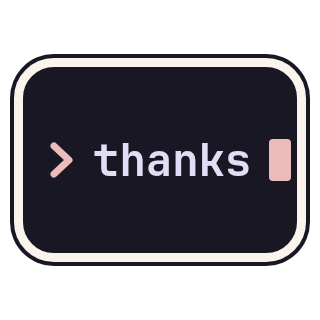: "thanks" typed at the prompt. Related emoji: 🙏.
- 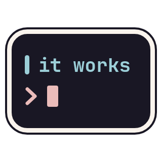: "it works" as an answer in the log, and the prompt waiting. Related emoji: ✅.
- : The rocket rising out of the mountains at dusk. Related emoji: 🚀.
- 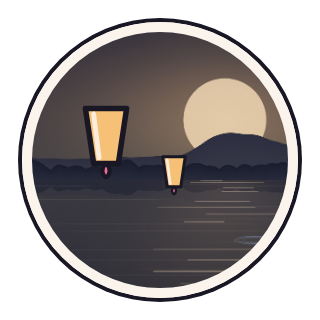: Sky lanterns over the pond under the moon. Related emoji: 🌙.

* Role icons

64 × 64 PNG with a clear background: a colored disc with a dark sign, each in one of Rosé Pine's
colors. Discord asks for 64 × 64 and up to 256 KB (PNG or JPG), from boost level 2. Upload in Server
Settings → Roles → a role → Display → Role Icon.

- : The prompt's chevron and caret, on rose. For the maintainer.
- : A wrench, on foam. For people whose code or docs are in Kolahal.
- 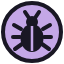: A bug, on iris. For testers of builds before release.
- : A script's braces, on gold. For people who share scripts and widgets.
- : A sun over ridges, on love. For people who share shaders and scenes.
